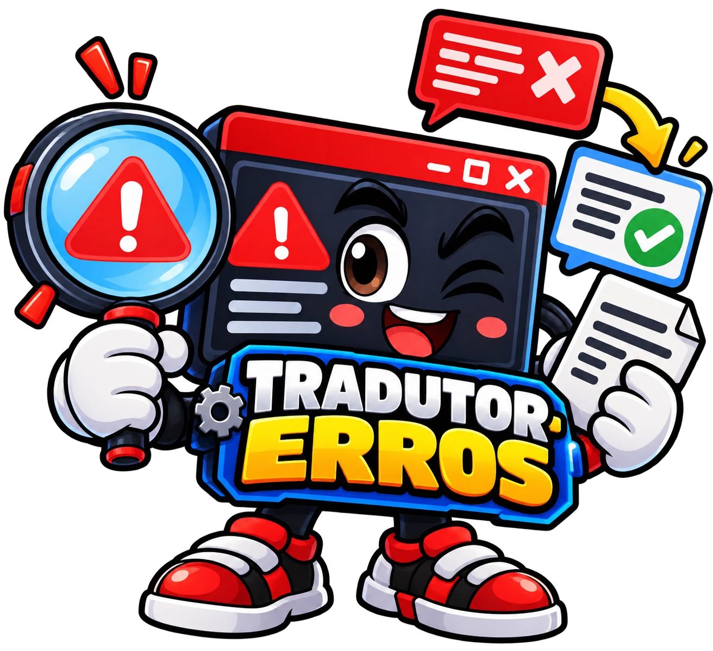

# agent-pc

Agentes e comandos do [Claude Code](https://claude.com/claude-code) para cuidar de um PC Windows: diagnosticar o hardware, sugerir limpezas e explicar mensagens de erro, tudo em português simples.

Todos os agentes são **somente leitura**: eles analisam o PC e sugerem o que fazer, mas não alteram configurações nem apagam arquivos.

## Agentes

<table>
  <tr>
    <td align="center" width="33%">
      <br>
      <b>diagnostico-pc</b>
    </td>
    <td align="center" width="33%">
      <br>
      <b>limpeza-pc</b>
    </td>
    <td align="center" width="33%">
      <br>
      <b>tradutor-erros</b>
    </td>
  </tr>
  <tr>
    <td valign="top">Analisa processador, placa de vídeo, memória, monitores e plano de energia. Aponta gargalos, configurações erradas e causas de travadas em jogos e emuladores.</td>
    <td valign="top">Mostra o que ocupa espaço no disco, quais programas abrem com o Windows e o que está pesando agora. Separa o que pode ser limpo sem medo do que é preciso conferir antes.</td>
    <td valign="top">Explica mensagens de erro de jogos, emuladores, programas e do Windows: o que significam, por que acontecem e como resolver. Consulta o Visualizador de Eventos e pesquisa na internet.</td>
  </tr>
</table>

| Agente | Ferramentas | Arquivo |
|---|---|---|
| `diagnostico-pc` | PowerShell, Read | [.claude/agents/diagnostico-pc.md](.claude/agents/diagnostico-pc.md) |
| `limpeza-pc` | PowerShell, Read | [.claude/agents/limpeza-pc.md](.claude/agents/limpeza-pc.md) |
| `tradutor-erros` | PowerShell, Read, WebSearch, WebFetch | [.claude/agents/tradutor-erros.md](.claude/agents/tradutor-erros.md) |

## Skills (comandos `/`)

Cada agente tem um comando com o mesmo nome. O comando é o atalho e o agente faz o trabalho. O que você escrever depois do comando é passado para o agente.

| Comando | Exemplo | Arquivo |
|---|---|---|
| `/diagnostico-pc` | `/diagnostico-pc liguei o XMP, confere se está certo` | [.claude/skills/diagnostico-pc/SKILL.md](.claude/skills/diagnostico-pc/SKILL.md) |
| `/limpeza-pc` | `/limpeza-pc meu SSD está cheio` | [.claude/skills/limpeza-pc/SKILL.md](.claude/skills/limpeza-pc/SKILL.md) |
| `/tradutor-erros` | `/tradutor-erros o PCSX2 deu "GS plugin failed to open"` | [.claude/skills/tradutor-erros/SKILL.md](.claude/skills/tradutor-erros/SKILL.md) |

Os comandos só rodam quando você chama, nunca sozinhos.

## Como usar

1. Abra uma sessão do Claude Code nesta pasta.
2. Use um dos jeitos abaixo:
   - **Comando:** digite `/` e escolha `/diagnostico-pc`, `/limpeza-pc` ou `/tradutor-erros`.
   - **Pelo nome:** "usa o agente limpeza-pc para ver o que posso limpar".
   - **Com @:** digite `@`, escolha o agente e escreva o pedido.

Se os comandos não aparecerem logo depois de baixar o repositório, rode `/reload-skills` ou abra uma sessão nova.

## Estrutura

```
agent-pc/
├── .claude/
│   ├── agents/      # definição de cada agente (instruções e ferramentas)
│   └── skills/      # comandos / que chamam os agentes
├── assets/          # mascotes dos agentes
└── README.md
```
